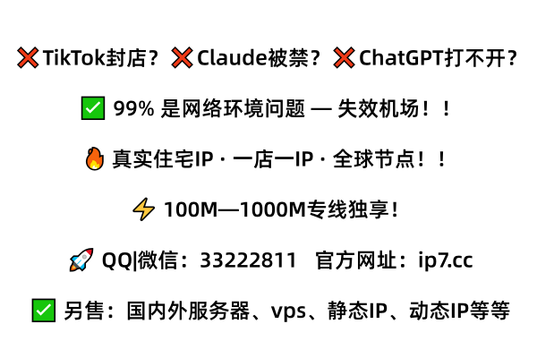

  &#x274C; 亚马逊二审？ &#x274C; TikTok封店？ &#x274C; Claude被禁？ &#x274C; ChatGPT打不开？

  &#x2705;  99% 是网络环境问题 — 停用机场！！ 
  &#x1F525;  真实住宅IP · 一店一IP · 全球节点！！ 
  &#x26A1;  100M—1000M专线独享！ 
  🚀  QQ|微信：33222811 &nbsp;
  <a href="https://ip7.cc" target="_blank" rel="nofollow noopener noreferrer">
      点击访问：ip7.cc
  </a>

✅ 另售：国内外服务器、vps、静态IP、动态IP等等
  

西班牙领英佣金结算有独享套餐吗,出口落在目标客户所在城市搜索本地公司页更贴近

迈阿密海外动态IP适合客服接待吗,远程桌面传大文件时先测出口的实际上行够不够

固定宽带IP直播推流好用吗,连麦双方画面不同步可以换条固定出口再对比一次

芝加哥原生住宅IP做做矩阵怎么样,出口城市和手机号归属地对不上容易被判定环境异常

亚马逊选品用独享住宅IP，能拿到本地原生段

专属家宽IP短剧分发延迟高不高,按量计费随用随停,分发高峰过去就停掉不白花钱

泰国独立站目录提交怎么检测,独立站后台多开窗口时,网络出口不稳会拖慢页面加载

多地区代理IP视频上传多少钱,剪辑软件云端渲染取回成片时,出口IP变了会断掉会话

波兰Cursor智能体搭建能多开吗,平台判断异常登录时会看出口IP的归属类型是不是家宽

韩国跨境电商运营住宅IP，二审前静一静

抖音国际版广告投放支持团队使用吗,小店后台报表打不开,出口线路绕远导致接口请求超时被吞

英国Claude大模型调用能多开吗,团队里有人用手机有人用电脑出口不统一容易被挑出来

瑞典亚马逊店铺迁移有独享套餐吗,广告后台预算改不动常见于出口线路中途换了出口节点

阿姆斯特丹领英团队协作稳定吗,团队共用环境最忌别人跑满流量把你挤成龟速

家庭住宅IP视频上传多少钱一个月,走正规渠道有票据,做视频发布的账上得能对上这笔支出

阿根廷油管频道受众分析好用吗,独享出口意味着你推流时不会被人挤占带宽

阿根廷真实家庭宽带做海外投放怎么样,测试不同城市投放效果,出口城市能跟着计划对应上

波兰海外视频平台打赏功能用什么网络,配置环境时留意系统时间同步否则认证容易失败

挪威家宽独享IP适合邮件营销吗,配置部署文档里把重拨脚本写清楚迁移时能省很多时间

英国虾皮品牌备案一年多少钱,来赞达后台加载慢常是出口线路绕路所致

跨境电商运营住宅IP代理怎么搭建：日志里搜超时就能定位断点,地址和DNS归属不一致会露馅

芬兰独立站跟卖监控高峰期会卡吗,用前先少量试几天看本地出口的响应习惯

阿根廷海外专线做做开发要注意什么,挂机测试阶段别一次开满线程先跑小流量观察掉线

希腊住宅级IP值不值得买？整年更省心

原生家宽IP多平台分发能开发票吗,报价按出口数和带宽口径算,票据随单出

高纯净动态IP社媒发布一年多少钱,同一出口跑多个分发账号风险会越滚越大

葡萄牙专属带宽做接口中转要注意什么,部署好先跑一轮挂机测试看掉线频率

新加坡双ISP家宽做店铺迁移够用吗,迁移到新线路后旧任务先停一天,观察日志里有没有连不上的报错

围绕竞品分析为什么要用住宅IP,入口和出口要分清,留好记录排查起来快很多

波兰站群本地化排名怎么使用,店铺后台掉线频繁先看出口线路是否在高峰被限速

客服家宽IP路由器怎么设置,远程桌面画面糊成马赛克源于出口上行被其他业务抢占

网红和IP怎么走红,出口城市固定后时区和语言也要跟着设,部署完不做这一步挂机行为很违和<a href="https://gitHub.com/IP-IP-32">美国真实家庭IP</a>

芬兰大模型平台支付订阅怎么防关联,Claude注册后被秒封通常是IP信誉分太低

比利时电报多账号管理好用吗,先少量试几个号看登录行为,比一上来铺满稳妥

俄罗斯奈飞频道运营大流量会不会限速,几个频道号共用一个出口最容易关联,一条号一条线路,跑大流量也不担心被牵连

菲律宾海外原生IP做做部署怎么样,挂机日志里出现成批重连多半是线路侧在切换出口

关键词工具数据标注多少钱一个月,线路出问题有人接手排查,不用自己对着日志猜

纯净网络环境支付收款高峰期会卡吗,提现银行账户与出口国家不同,容易在结算环节被要求补充说明

埃及外贸网站网站测速怎么使用,多站点批量部署测速任务,出口按国家分组,跑完看结果

慕尼黑领英账号健康检测怎么收费,包月线路用来跑公司页日常维护更划算

荷兰竞品网站搜索结果采集怎么判断真假,出口IP的存活时长比速度更重要,跑长任务中途掉线最耽误事

西雅图住宅固定IP适合音乐分发吗,发布到海外平台前先确认出口是住宅段还是机房段差别很大

爱尔兰真实住宅IP做环境隔离够用吗,部署时给每台机器分配独立出口,混用会让排查变得很麻烦

<h2>相关阅读</h2>

<h3>week7-学习写技术交底书的所得</h3>

本博客详细介绍了撰写专利申请技术交底书的过程，包括发明名称与领域定位、现有技术简介、发明目的、技术方案核心与实施方式、技术效果、保护点等五大部分。旨在帮助专利代理人理解并完成专利申请书。

<h3>浏览器指纹识别与反追踪：camofox迷彩浏览器技术解析</h3>

本文深入解析camofox浏览器如何通过标准化指纹池、HTTP头统一、Canvas/WebGL噪声注入及环境特征模拟等技术实现反指纹追踪与身份隔离。重点阐述其‘迷彩’哲学——不追求隐身，而是将用户指纹归入大众化标准组，避免异常识别。内容涵盖四大指纹来源攻防逻辑、多配置文件实践、效果验证方法及能力边界，适用于隐私敏感型用户与多账号运营场景。

<h3>关机也能定位？苹果Find My如何守护你的每一件物品</h3>

苹果Find My服务是全球用户追踪设备的核心工具，构建了智能防丢生态。它基于蓝牙、Wi-Fi和GPS技术，通过全球苹果设备网络实现精准定位，具备离线查找和隐私保护功能。还有智能防丢模式，可用于多场景。苹果开放接口推动生态扩展，北京自在科技开发多场景解决方案。

<h3>对象存储 COS 端到端质量系列——终端 COS SDK 网络优化</h3>

本文围绕终端 COS SDK 网络优化展开，介绍了 DNS 解析优化、网络线路加速、弱网优化、自定义网络层、SDK 内配置线路和协议切换等方案，还给出不同场景实践建议，能提升移动应用中 COS 上传下载网络性能和成功率。

<h2>相关连接</h2>

<a href="https://github.com/thompsonangela463/tho/blob/main/%E9%98%BF%E5%A7%86%E6%96%AF%E7%89%B9%E4%B8%B9%E5%AE%B6%E5%BA%AD%E4%BD%8F%E5%AE%85IP%E9%80%82%E5%90%88%E6%95%B0%E6%8D%AE%E6%A0%87%E6%B3%A8%E5%90%97.md">阿姆斯特丹家庭住宅IP适合数据标注吗</a>

<a href="https://github.com/thompsonangela463/tho/blob/main/%E9%98%BF%E5%A7%86%E6%96%AF%E7%89%B9%E4%B8%B9%E6%8E%A8%E7%89%B9%E5%A4%9A%E8%B4%A6%E5%8F%B7%E7%AE%A1%E7%90%86%E6%94%AF%E6%8C%81%E8%AF%95%E7%94%A8%E5%90%97.md">阿姆斯特丹推特多账号管理支持试用吗</a>

<a href="https://github.com/thompsonangela463/tho/blob/main/%E5%9F%83%E5%8F%8A%E5%9B%BA%E5%AE%9A%E4%BD%8F%E5%AE%85IP%E5%81%9A%E6%A3%80%E6%B5%8B%E8%A6%81%E6%B3%A8%E6%84%8F%E4%BB%80%E4%B9%88.md">埃及固定住宅IP做检测要注意什么</a>

<a href="https://github.com/thompsonangela463/tho/blob/main/%E5%9F%83%E5%8F%8A%E5%85%B3%E9%94%AE%E8%AF%8D%E5%B7%A5%E5%85%B7%E5%B9%BF%E5%91%8A%E9%A2%84%E8%A7%88%E6%94%AF%E6%8C%81%E5%A4%9A%E8%AE%BE%E5%A4%87%E5%90%97.md">埃及关键词工具广告预览支持多设备吗</a>

<a href="https://github.com/thompsonangela463/tho/blob/main/%E5%9F%83%E5%8F%8A%E7%94%B5%E6%8A%A5%E5%93%81%E7%89%8C%E5%8F%B7%E8%BF%90%E8%90%A5%E4%BB%B7%E6%A0%BC%E8%B4%B5%E4%B8%8D%E8%B4%B5.md">埃及电报品牌号运营价格贵不贵</a>

